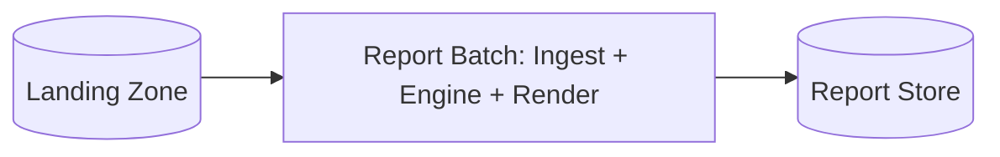
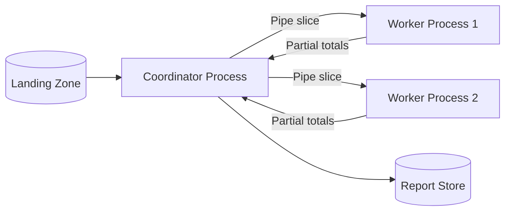
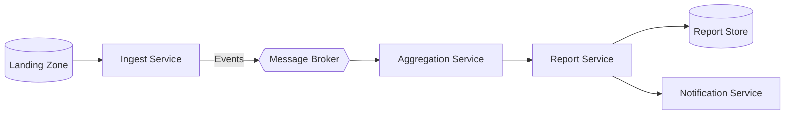

# ATAM-Style Evaluation: Release 1 Architecture Candidates

## Business Drivers
- **Prompt Delivery**: Head office must receive monthly sales reports for month M by 08:00 on day 2 of month M+1 (brief).
- **High Data Volume**: Process ~3.0 million transactions per month across 3 branches (PNH, REP, BTB) accurately using `BigDecimal` arithmetic.
- **Unreliable Network Resilience**: Tolerate intermittent branch internet link outages and late daily file uploads without losing data or producing duplicates (QA-3).
- **Strict Role Security**: Enforce branch data isolation so branch managers only access their own store's data (QA-5).
- **Cost & Resource Constraints**: Small team (2 developers), rapid delivery timeline, standard 8-core server infrastructure without full-time operations staff.

## Candidates

### Candidate A: Modular Monolith Batch (One JVM)
Single JVM process running scheduled batch jobs with separated logical packages (`model`, `ingest`, `engine`, `render`).

### Candidate B: Process Pipeline (Coordinator & Worker Processes)
Coordinator process forks worker processes over OS pipes / local sockets; workers parse CSV slices and stream partial aggregations back to the coordinator.

### Candidate C: Event-Driven Microservices
Distributed services (`Ingest Service`, `Aggregation Service`, `Report Service`, `Notification Service`) decoupled asynchronously via a message broker (Kafka / RabbitMQ).

## Scenario Analysis

| Scenario | Candidate A: Monolith Batch | Candidate B: Process Pipeline | Candidate C: Event Microservices |
|----------|-----------------------------|-------------------------------|----------------------------------|
| **QA-1: Performance** (3 M rows in $\le 60\text{ s}$) | **++** In-memory processing with zero network or IPC overhead comfortably completes in ~5 s. | **+** Parallel worker processes scale on multi-core, completing in ~7.3 s with minor pipe IPC overhead. | **−** High message serialization and network hops across broker risk failing 60 s limit unless heavily batched. |
| **QA-2: Scalability** (Grow to 9 M rows) | **0** Bound to vertical scaling of single server; requires sufficient RAM. | **+** Can easily spin up more local worker processes to utilize extra CPU cores. | **++** Horizontally scales individual service instances independently across multiple nodes. |
| **QA-3: Availability** (Branch link outage) | **+** Landing zone buffers files; batch re-run is completely idempotent. | **+** Coordinator retries failed worker slices; re-runs remain idempotent. | **++** Broker natively buffers incoming messages and decouples services during downstream downtime. |
| **QA-4: Modifiability** (Add export format) | **++** Strategy pattern (`ReportRenderer`) isolated to a single new class in $< 0.5$ days. | **+** Modifying renderer touches only report coordinator/render step. | **+** Adding a renderer involves adding an independent consumer service, but requires extra deployment scaffolding. |
| **QA-5: Security** (Manager sees own branch) | **+** Simple internal authorization barrier within the web UI layer. | **+** Process isolation between workers, but shared filesystem perimeters. | **−** Larger attack surface with multiple network ports, service endpoints, and broker ACLs. |
| **QA-6: Testability** (Tests run in $< 30\text{ s}$) | **++** Fast in-memory JUnit tests without mocks, containers, or network setup. | **0** Requires integration tests testing OS process spawning, IPC timeouts, and pipe management. | **−** Requires embedded brokers/Testcontainers, increasing test suite duration and flaky tests. |
| **Cost & Team Skills** | **++** Native Java 25 and Maven; lowest operational overhead for a 2-person team. | **0** Moderate complexity in managing child processes, IPC failure handling, and signals. | **−−** High infrastructure cost, operational overhead, and maintenance of distributed broker. |

## Quantitative QA-1 Estimates

### Assumptions
1. Total monthly volume: $3.0\times 10^6$ rows.
2. Ingestion & parsing: $5\ \mu\text{s}$ per row on a single core ($3.0\text{ M} \times 5\ \mu\text{s} = 15.0\text{ s}$ total CPU parse time).
3. Serial components: Aggregation merge ($2.0\text{ s}$) and rendering ($1.0\text{ s}$) are sequential ($3.0\text{ s}$ serial time).
4. Hardware: 8 CPU cores.
5. Amdahl's Law: $S(N) = \frac{1}{(1-p) + \frac{p}{N}}$, where parallel fraction $p = \frac{15}{18} \approx 0.833$ and $1-p = \frac{3}{18} \approx 0.167$.
   - Speedup on $N = 8$: $S(8) = \frac{1}{0.167 + \frac{0.833}{8}} = \frac{1}{0.167 + 0.104} = \frac{1}{0.271} \approx 3.69$.
   - Overall time: $\frac{18\text{ s}}{3.69} \approx 4.9\text{ s}$.

### Candidate Computations
- **Candidate A (Modular Monolith Batch)**:  
  Using 8 parser threads:
  $$\text{Time} = \frac{15.0\text{ s}}{8} + 2.0\text{ s} + 1.0\text{ s} = 1.88\text{ s} + 3.0\text{ s} = 4.88\text{ s} \approx 4.9\text{ s} \quad (\ll 60\text{ s, PASS})$$

- **Candidate B (Process Pipeline)**:  
  Using 4 worker JVM processes (JVM startup overhead ~0.5 s in parallel, partial totals serialization negligible):
  $$\text{Time} = 0.5\text{ s} + \frac{15.0\text{ s}}{4} + 2.0\text{ s} + 1.0\text{ s} = 0.5\text{ s} + 3.75\text{ s} + 3.0\text{ s} = 7.25\text{ s} \approx 7.3\text{ s} \quad (\ll 60\text{ s, PASS})$$

- **Candidate C (Event-Driven Microservices)**:  
  - *Fine-grained (1 row per message)*: Broker throughput is ~50,000 msg/s.
    $$\text{Broker transfer time} = \frac{3,000,000\text{ msgs}}{50,000\text{ msg/s}} = 60.0\text{ s}$$
    Adding parsing and network serialization overhead yields $\approx 65\text{ s}$ ($\gt 60\text{ s, FAILS QA-1}$).
  - *Coarse-grained (1,000 rows per batch event)*:
    $$\text{Broker transfer time} = \frac{3,000\text{ batches}}{50,000\text{ msg/s}} = 0.06\text{ s}$$
    Total time $\approx 5.0\text{ s}$ ($\ll 60\text{ s, PASSES QA-1}$).

## Sensitivity Points
- **S1 (Threading parallelism in Monolith)**: The number of worker threads parsing CSV files directly scales execution time from $18\text{ s}$ down to $4.9\text{ s}$ on 8 cores (affects QA-1).
- **S2 (Event batch size in Candidate C)**: The batching granularity of messages through the message broker shifts broker transfer time by three orders of magnitude ($60\text{ s}$ at 1 row/msg vs $0.06\text{ s}$ at 1,000 rows/msg), determining whether QA-1 is met or violated.
- **S3 (IPC buffer size in Candidate B)**: The pipe buffer size directly impacts context switching and backpressure latency between worker processes and coordinator (affects QA-1 and memory consumption).

## Trade-off Points
- **T1 (Decoupled Message Broker vs. Direct In-Memory Batch)**: Introducing a message broker improves availability and buffering during link failures (+QA-3), but introduces serialization latency, deployment complexity, financial infrastructure costs, and a broader attack surface (−QA-1, −Cost, −QA-5).
- **T2 (Process Isolation vs. Operational Simplicity)**: Splitting into separate OS processes (Candidate B) prevents a single crash from killing the coordinator (+Availability), but increases debugging difficulty, IPC serialization cost, and CI test execution time (−QA-1, −QA-6).

## Risks, Non-Risks, and Risk Themes

### Risk Theme 1: Operational Complexity and Deadlines
- **Risk R1**: Adopting Candidate C would introduce significant distributed systems overhead (broker administration, partition rebalancing, eventual consistency debugging), likely causing the 2-developer team to miss the 6-hour delivery deadline.
- **Non-Risk NR1**: Candidate A running on Java 25 provides deterministic, single-JVM execution that eliminates distributed operational failure modes completely.

### Risk Theme 2: Financial Calculation Accuracy and Integrity
- **Risk R2**: Message replay or uncoordinated worker re-runs in Candidates B/C could inadvertently duplicate transactions, violating financial reporting integrity.
- **Non-Risk NR2**: In Candidate A, using `BigDecimal` with `RoundingMode.HALF_UP` inside immutable record structures ensures exact precision with zero floating-point drift across all aggregations.

## Recommendation
We **confirm ADR-0001 (Modular Monolith Batch Application)**.  
Candidate A is the optimal architecture for Release 1: it easily satisfies the performance goal ($4.9\text{ s} \ll 60\text{ s}$), maximizes testability ($< 5\text{ s}$ test suite), minimizes operational surface area, and meets all architectural drivers within the team's capacity. Candidates B and C add unnecessary operational complexity without delivering proportional business value at the current 3-million-row scale.
