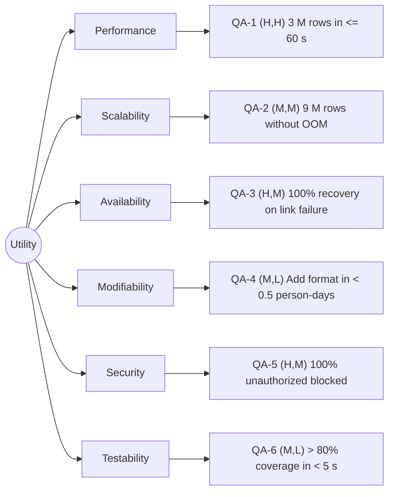

# Quality-attribute scenarios: Angkor Mart monthly sales report

## Stakeholders
- Head-office analyst: Views and exports all reports (PDF, Excel).
- Branch manager (PNH, REP, BTB): Views their own branch's report on a web page.
- Finance director: Receives an e-mail when a report is ready.
- Operations person: Runs the report job at 06:00 on day 2 of M+1.
- Developers (Your team): Maintains the system, adds features, and handles anomalies.

## Scenarios
| ID | Attribute | Source | Stimulus | Artifact | Environment | Response | Response measure | Rank |
|----|-----------|--------|----------|----------|-------------|----------|------------------|------|
| QA-1 | Performance | Scheduler, 06:00 on day 2 of M+1 | Starts the report for a month of about 3 M rows | Report engine | Normal operation, 8-core server, files complete | Report files written, "ready" event published | <= 60 s wall-clock, median of 5 runs after 2 warm-up runs | (H,H) |
| QA-2 | Scalability | Business Growth | Number of branches increases, tripling data volume to 9 M rows/month | Report engine | Normal operation, same 8-core server | System completes processing without crashing | <= 180 s wall-clock, 100% of reports generated without OutOfMemory errors | (M,M) |
| QA-3 | Availability | Branch network | Branch internet link fails during data transfer before 23:00 | File ingest system | Normal operation | System retries or flags missing files, resumes without data corruption | 100% of missing data recovered within 1 hour of link restoration, 0 duplicate rows | (H,M) |
| QA-4 | Modifiability | Developers | Request to add a new output format (e.g., JSON) | Report renderer | Design time | Developer implements the change without modifying existing code | < 0.5 person-days of effort, changes isolated to 1 new class | (M,L) |
| QA-5 | Security | Branch manager | Attempts to view the report of another branch | UI / Web page | Normal operation | Access is denied, only their own branch data is displayed | 100% of unauthorized access attempts blocked, logged within 1 second | (H,M) |
| QA-6 | Testability | Developers | Write unit tests for the CSV parser and calculation rules | Codebase | Development/CI time | Tests run successfully and verify BigDecimal money rules | > 80% line coverage for model/engine, tests complete in < 5 seconds | (M,L) |

## Rank justifications
- QA-1 (H,H): the report is due in the morning; 3 M rows with BigDecimal computations need careful performance tuning.
- QA-2 (M,M): adding branches is likely eventually, but 3M rows is current peak; linearly scaling processing is moderately difficult.
- QA-3 (H,M): branch links fail often; accurate revenue data is critical for the business, requiring robust failure recovery.
- QA-4 (M,L): new formats may be requested; the Strategy pattern makes adding new renderers straightforward and isolated.
- QA-5 (H,M): strict data visibility rules (branch managers see their own branch only) are critical for confidentiality and require careful authorization checks.
- QA-6 (M,L): testing calculations is important for financial software, but standard JUnit makes unit testing straightforward.

## Assumptions
- A1: the report server has 8 cores and an SSD (to confirm with the client).
- A2: "Branch internet link fails" means files might be partial or delayed, but not corrupted in the middle of lines if using proper protocols.
- A3: Security for the web page is handled via standard authentication/authorization tokens.

## Utility tree

## Architectural drivers
QA-1, QA-3, QA-5
